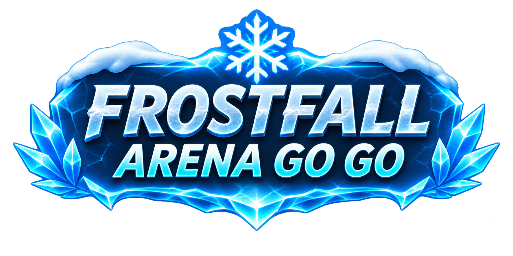
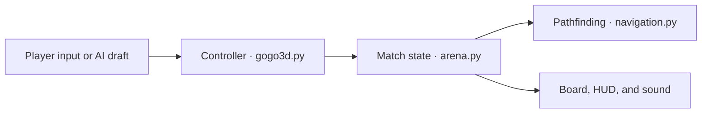

<p align="center">
  
</p>

# Frostfall Arena Go Go 3D

**A local 3D penguin auto-battler built with Python and Panda3D.**

Spend shells to recruit a squad, arrange your formation on an 8 × 5 ice board, and upgrade the heroes you want to keep. After the 3–2–1 countdown, both teams fight automatically. A well-placed Glacier can shield the front line, while Wisp can blink behind it to reach a vulnerable marksman.

[Quick start](#quick-start) · [How to play](#how-to-play) · [Hero roster](#hero-roster) · [AI strategies](#ai-strategies) · [Project structure](#project-structure) · [Game guide PDF](output/pdf/Frostfall%20Arena%20Go%20Go%203D%20-%20Game%20Guide.pdf)

[Earlier Frostfall builds and variants](versions/README.md)

## Quick start

On Windows, open [Play Arena Go Go 3D.cmd](Play%20Arena%20Go%20Go%203D.cmd). The launcher checks this project's `.venv` first, then tries a system Python installation with Panda3D available. All game source and assets are bundled in this repository.

For a fresh checkout, run these commands in PowerShell from the project folder. Use Python 3.10 or newer with a wheel for the pinned Panda3D version.

```powershell
python -m venv .venv
.\.venv\Scripts\python.exe -m pip install -r requirements.txt
.\.venv\Scripts\python.exe gogo3d.py
```

The repository includes the game art, sound effects, and menu video. Normal play requires the runtime in [requirements.txt](requirements.txt).

## Game modes

| Mode | Who drafts | Setup |
| --- | --- | --- |
| **Human vs Human** | Two players share one screen and mouse. | Each team gets a randomly drawn hand. |
| **Human vs AI** | You play Coral against Azure. | Pick Minimax, MCTS, or Greedy for Azure. MCTS is the default. |
| **AI vs AI** | Both squads draft automatically. | Choose each team's algorithm separately. The two teams share the first opening hand and the regular draw sequence. In later rounds, each team's shop starts with its own previous lineup. |

## How to play

1. **Draft.** Each round starts with an empty board. Both teams get **15 shells in Round 1**, **16 in Round 2**, and **18 in Round 3**. You can field up to **5 heroes**. Click or drag a card onto an empty tile to buy it and refill its slot from **Next**.
2. **Set your formation.** Move a deployed hero to another friendly tile or swap it with a teammate already there. Right-click an unselected deployed hero to sell it and recover part of its original cost.
3. **Upgrade and Ready.** Click **Upgrade** and choose a gold-highlighted hero. Each team receives **1, 2, then 3 upgrade uses** across the rounds and can upgrade each hero once per round, up to rank 4. Both teams can lock in early. If the opening **32-second draft timer** expires with an empty team, the game waits for both sides to field a hero.
4. **Watch the battle.** After **3–2–1**, the combat clock counts down from **00:25**. Both teams can enter the center columns. The round ends on elimination or at the time limit. At timeout, the higher percentage of remaining team health wins. A tie awards neither team a point.
5. **Draft again or rematch.** The first team to two wins takes the match. After three rounds, equal scores draw. In rounds two and three, the previous squad goes into the four shop slots and **Next** in purchase order. Regular rank 1 cards fill any gaps. A returning hero keeps its rank and costs **1 extra shell per rank above 1**. Setup for those rounds is untimed.

### Controls

| Input | Action |
| --- | --- |
| **Left click / drag** | Buy, deploy, move, swap, or select an upgrade target. |
| **Right click** | Cancel the current selection, or sell a deployed hero when nothing is selected. |
| **1 / 2 / 3** | From Home or How to Play, open Human vs AI, Human vs Human, or AI vs AI. |
| **Space** | Start from AI setup, toggle Coral Ready in Human vs AI, or advance from results. |
| **U** | Toggle Coral's Upgrade selection when Coral is human-controlled. |
| **V** | Switch between angled and overhead views. |
| **P / Esc** | Pause or resume with **P**. **Esc** closes a dialog, clears a selection, or pauses an active match. |
| **F10 / F11** | Fit the window to the desktop or toggle borderless fullscreen. |

## Hero roster

Stats below are for **rank 1**. Each higher rank adds **31% of base HP**, **27% of base attack damage**, and **30% of the base skill amount**. Both teams use the same stats and abilities with different sprite artwork.

| Hero | Role | Cost | HP | Damage / interval | Skill |
| --- | --- | ---: | ---: | --- | --- |
| Glacier | Tank | 3 | 350 | 23 / 1.12 s | **Ice Dome** shields Glacier and nearby allies. |
| Cinder | Mage | 4 | 170 | 24 / 1.15 s | **Snowfire** hits the target and nearby enemies. |
| Rime | Marksman | 3 | 158 | 24 / 0.63 s | **Frost Volley** hits and slows a target. |
| Wisp | Assassin | 3 | 178 | 36 / 0.85 s | **Night Slip** blinks beside a backline target when a landing tile is open. |
| Tide | Fighter | 2 | 240 | 31 / 0.94 s | **Tidal Rush** deals damage, stuns, attempts a knockback, and heals Tide. |

The [game guide](output/pdf/Frostfall%20Arena%20Go%20Go%203D%20-%20Game%20Guide.pdf) has preferred placements, ranges, cooldowns, skill values, and stat tables for ranks 1–4.

## AI strategies

The selected algorithm decides **how the AI drafts**. During combat, every squad uses the same targeting, ability, damage, and movement rules.

| Planner | How it chooses |
| --- | --- |
| **Greedy** | Takes the highest-rated legal action using an immediate evaluation of the draft. |
| **Minimax** | Searches draft moves and counterpicks with iterative deepening and alpha-beta pruning. In private drafts it samples a plausible opponent hand. |
| **MCTS** | Samples continuations, simulates battles, and prefers actions supported by its rollouts. |

Use `--seed` to repeat the random parts of the shop deals. Returning cards depend on the previous round’s lineup. To launch a seeded match directly or compare planners, run:

```powershell
.\.venv\Scripts\python.exe gogo3d.py --mode cpu --azure-ai mcts --seed 42
.\.venv\Scripts\python.exe gogo3d.py --mode showdown --coral-ai minimax --azure-ai greedy --mute
```

## Project structure



| Source | Responsibility |
| --- | --- |
| [gogo3d.py](gogo3d.py) | Application entry point, input, modes, camera, match loop, and background AI work. |
| [arena.py](arena.py) | Hero data, draft legality, economy, combat, ranks, timers, and scoring. |
| [navigation.py](navigation.py) · [planners.py](planners.py) | A* approach routes and the three AI draft algorithms. |
| [gogo_hud.py](gogo_hud.py) · [gogo_ui_kit.py](gogo_ui_kit.py) | Screen layouts, clickable controls, HUD feedback, and sprite-sheet regions. |
| [gogo_stage.py](gogo_stage.py) · [gogo_tiles.py](gogo_tiles.py) · [sprites.py](sprites.py) | Board geometry, tile selection, fighter sprites, and combat animations. |
| [gogo_scenery.py](gogo_scenery.py) · [gogo_sound.py](gogo_sound.py) | Home video and arena backdrop, plus the wind and event cue mixer. |
| [gogo_runtime/](gogo_runtime/) | Go Go 3D's Panda3D window, input handling, HUD primitives, ice panels, geometry, and edge smoothing. |

The rules advance in fixed **1/60-second steps**. The controller sends a copy of the draft to the AI worker and applies its chosen action to the live match on the main thread. The HUD and 3D scene display the resulting state.

## Rebuild assets

| Task | Command | Extra tools |
| --- | --- | --- |
| Regenerate sprite atlases and card portraits | `python build_sprite_atlases.py` | Pygame |
| Regenerate the bundled WAV effects | `python build_sound_effects.py` | Runtime dependencies |
| Render a replacement home loop | `python build_home_loop.py source.mp4 home-loop.mp4` | FFmpeg and ffprobe |

Run the builders with the same Python environment as the game. The home-loop builder writes a new MP4 that you can preview before replacing `assets/home-background.mp4`.

## Development history

The first 20 commits reconstruct the development milestones of the completed Go Go 3D project. Their author timestamps use a planned overnight schedule in Dhaka time. Git records the actual date this history was assembled separately as the committer date.
