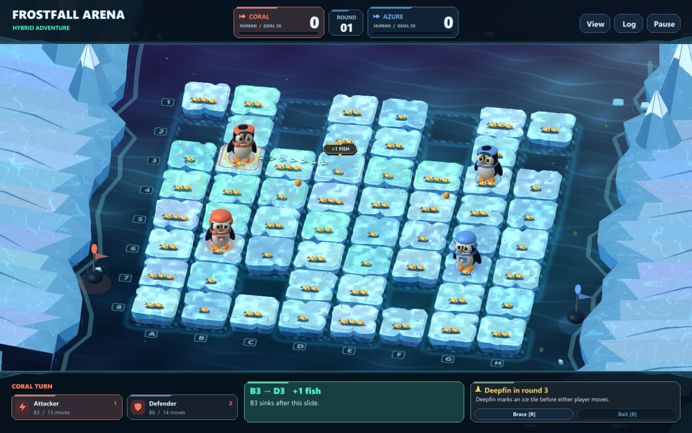

# Frostfall Arena

Frostfall Arena is a local Arctic strategy game built in Python with 3D Panda3D and Pygame clients. Slide two penguins across an 8×8 board and collect fish as soon as you land. The starting floe of each normal slide sinks, so plan around the gaps you create.

## Play Frostfall Arena 3D

On Windows, double-click **Play Frostfall Arena 3D.cmd**. The Panda3D client uses the same rule engine, Minimax, and MCTS.

On a fresh install, install the 3D dependency and run the preview from the project folder.

```sh
python -m pip install -r requirements-3d.txt
python arena3d.py
```

Click the Attacker or Defender card, hover over a lit tile to preview the route and score, then click to slide. In Hybrid Adventure, **reach 30 fish or trap your rival**. Press **R** to keep the Defender’s starting floe and any bait pickup in play as it slides. Each team can brace once. Deepfin first appears in round 3. Use **V** to switch cameras, **L** to open the event log, and **P** to pause.

Each new board starts with eight missing floes, mirrored across the arena. Generation preserves the starting tiles, bait pickups, connected ice, and at least seven opening destinations per penguin. A new match gets a new seed. Restart reuses the seed and its gaps.

Floe profiles vary across the grid, with chipped edges, etched fractures, and bands of exposed blue ice. Move and selection borders trace the outline of each floe. [See the board from above](screenshots/3d-glacier-overhead.png)

[3D gameplay clip](screenshots/3d-preview.mp4) · [3D title screen](screenshots/3d-menu.png)

Frozen pines, piled ice, and team beacons line the cove. Fish leap through the channels as broken ice drifts around the board. Watch for shaking floes in Hybrid Adventure. Deepfin the leopard seal breaches above its marked floe and dives back down through it. The Motion Effects setting pauses ambient animation.



## Play the Pygame edition

On Windows, double-click **Play Frostfall Arena.cmd**. It looks for an installed Python with Pygame, including a project virtual environment.

To install and launch from a terminal, use Python 3.11 or newer with pip.

```sh
python -m pip install -r requirements.txt
python main.py
```

From inside the `frostfall` folder on Windows, you can also run `py app.py`.

| Control | Action |
| --- | --- |
| Left click | Select a friendly penguin, then a highlighted destination |
| Right click or Esc | Clear the selection or cancel bait targeting |
| 1 / 2 | Select your attacker or defender |
| Arrow keys or WASD | Move the board cursor |
| Enter or Space | Confirm a tile or activate the focused button |
| B | Toggle bait targeting when available |
| R | Toggle the Defender's brace when available |
| P | Pause or resume |
| M / F11 | Toggle sound / fullscreen |
| Tab or Shift+Tab | Move keyboard focus between buttons |

**Classic** focuses on fish and melting ice. **Hybrid Adventure** adds Deepfin's warnings, strikes and rescue jumps, one-use bait, and the Frost Warden's temporary ice blocks. Choose a human or computer opponent, or use **AI Arena** to watch two algorithms play. In **Match Setup**, enter a seed to reuse a board. **Rematch** reuses the board and the same first team.

[Title screen](screenshots/menu.png) · [Compact window](screenshots/compact.png)

## Rules and AI

In Hybrid Adventure, a move that reaches 30 fish wins immediately. In either mode, the active team loses if it runs out of legal actions while the opponent can still act. When both teams run out, the higher fish score wins. Pending hazards and temporary ice blocks resolve before a team is declared trapped.

Both algorithms use the same immutable game state and action transitions as the playable match. Minimax visits every branch to the chosen depth, with rescue choices resolved without consuming a normal ply. MCTS uses UCT selection and guided rollouts capped at 28 actions. Both evaluate fish, mobility, role-specific positioning and hazard exposure. The interface runs search on a background worker.

Deepfin treats ice reachable by at least two penguins as tactically important, an approximation of route importance. Warden targeting also uses the number of penguins that can reach a tile. Both break ties deterministically from the board seed and round.

| Difficulty | Minimax depth | MCTS simulations per decision |
| --- | ---: | ---: |
| Quick | 1 | 80 |
| Standard | 2 | 200 |
| Deep | 3 | 500 |

## Verification

```sh
python -m unittest discover -s tests -v
python benchmark.py --workers 2
```

With Panda3D installed, `python -m unittest discover -s tests -p test_arena3d.py -v` checks the 3D client.

The included [benchmark results](benchmark-results.csv) were recorded under the previous departure-scoring rule. They cover 40 completed Standard matches on ten seeds per ruleset. Each seed was played twice per ruleset with the algorithms swapping teams and starting order. Timing measures searched decisions, with forced actions excluded. These timings were measured with two parallel workers on the development machine.

| Ruleset | Minimax wins | MCTS wins | Draws | Mean fish, Minimax / MCTS | Mean ms per searched decision, Minimax / MCTS |
| --- | ---: | ---: | ---: | --- | --- |
| Classic | 4 | 16 | 0 | 38.8 / 29.1 | 38.4 / 423.5 |
| Adventure | 16 | 4 | 0 | 29.8 / 22.6 | 101.6 / 428.9 |

## Fish Heist experiment

**Play Fish Heist.cmd** launches a separate 6×6 experiment. Skate over fish, bank them at your dock, or bump an adjacent rival to spill a fish. The first to bank eight wins. It uses plain Minimax at depth 3 and MCTS with 200 simulations. [Gameplay preview](screenshots/heist-preview.mp4)
